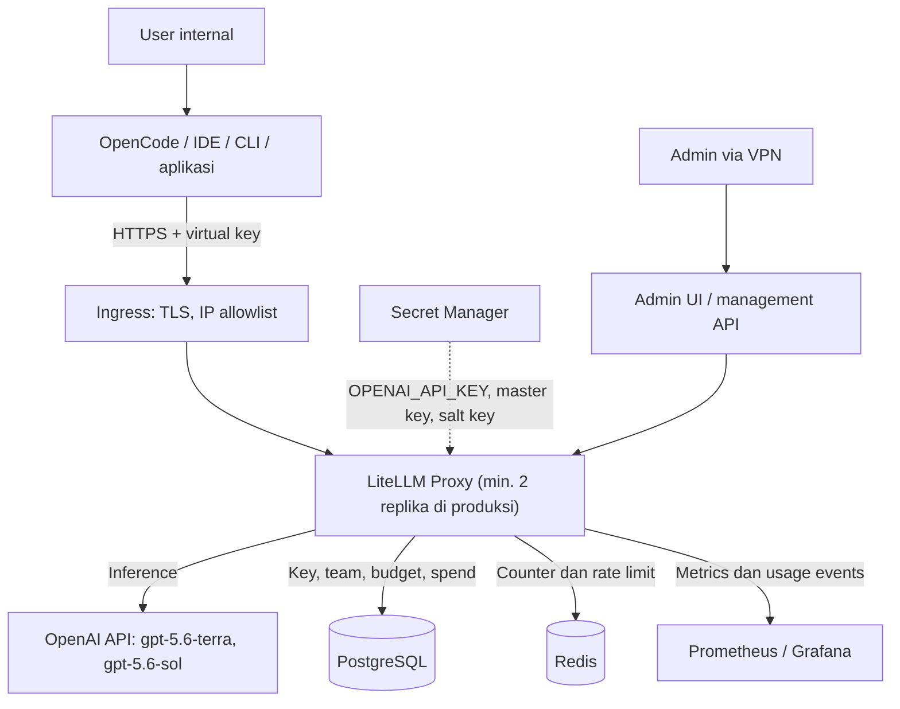

# Acuan Pengerjaan LiteLLM Gateway — Rilis Awal

Tanggal: 27 Oktober 2026
Diperbarui: 31 Oktober 2026 (spec `docs/superpowers/specs/2026-10-31-implementation-guide-sync-design.md`)
Status: Acuan kerja rilis awal
Acuan desain: `LLM_GATEWAY_ARCHITECTURE.md`
Keputusan pilot: `docs/superpowers/specs/2026-10-27-litellm-pilot-design.md`
Lingkup rilis awal: satu provider (OpenAI API), dua model (GPT-5.6 Terra dan GPT-5.6 Sol)

> Dokumen ini adalah turunan eksekusi dari dokumen arsitektur. Jika ada konflik, prinsip di dokumen arsitektur yang berlaku, lalu dokumen ini diperbarui. Semua contoh konfigurasi perlu diverifikasi terhadap versi LiteLLM dan OpenCode yang dipin.

---

## Daftar isi

1. [Ringkasan dan keputusan terkunci](#1-ringkasan-dan-keputusan-terkunci)
2. [Arsitektur rilis awal](#2-arsitektur-rilis-awal)
3. [Katalog alias model](#3-katalog-alias-model)
4. [Team, entitlement, dan policy](#4-team-entitlement-dan-policy)
5. [Konfigurasi referensi](#5-konfigurasi-referensi)
6. [Fase pengerjaan dan checklist](#6-fase-pengerjaan-dan-checklist)
7. [Skenario uji penerimaan](#7-skenario-uji-penerimaan)
8. [Runbook ringkas](#8-runbook-ringkas)
9. [Risiko dan mitigasi](#9-risiko-dan-mitigasi)
10. [Pertanyaan terbuka](#10-pertanyaan-terbuka)
11. [Referensi](#11-referensi)

---

## 1. Ringkasan dan keputusan terkunci

Target: LiteLLM proxy dipakai seluruh tim dalam **±7 minggu**, melalui 4 fase dengan 3 gate. Semua akses model lewat satu endpoint internal, setiap orang memegang virtual key sendiri, dan biaya bisa dibatasi serta dilacak per user dan per tim.

| Keputusan | Nilai rilis awal |
| --- | --- |
| Provider | **OpenAI API** (billing platform). Bukan langganan ChatGPT Plus/Pro/Team. |
| Model | `gpt-5.6-terra` (default harian), `gpt-5.6-sol` (tugas berat). ID lengkap dipin, bukan alias `gpt-5.6`. |
| Harga | Dipin per token di `deploy/litellm/config.yaml` (input, input cache, output); cost map tidak diunduh. Lihat §3.1 |
| Client utama | OpenCode, lalu IDE/CLI lain, Open WebUI, dan aplikasi internal |
| Deploy | Pilot: Docker Compose di 1 VM, dua replika (`litellm-a`, `litellm-b`), HTTP langsung ke `litellm-a`; TLS dan proxy oleh DevOps sebelum dipakai luas. Produksi: Kubernetes + Helm, minimal 2 replika |
| State | Managed PostgreSQL + managed Redis 7.0+ |
| Autentikasi | Virtual key individual per user; service account key per aplikasi |
| Administrasi | Admin UI bawaan + skrip provisioning. Portal custom hanya bila alur perusahaan menuntut |
| Caching | Response caching **mati** |
| Logging | Metadata saja. Prompt/output dan key mentah tidak disimpan |
| Kegagalan dependency | **Fail-closed**: jika key/budget tidak bisa diperiksa, request ditolak |
| Budget | Fail-closed juga untuk budget (`fail_closed_budget_enforcement: true`): request yang taksiran biaya terburuknya tidak muat di sisa budget ditolak |
| Lisensi | Open source. Evaluasi Enterprise bila butuh SSO/SCIM/audit log bawaan |

Di luar lingkup rilis awal: provider lain (Azure OpenAI, Gemini, DeepSeek, GLM), GPT-5.6 Luna, model lokal, portal custom, guardrail/PII masking otomatis, SCIM. Provider kedua direncanakan di Fase 4 (bagian 6).

---

## 2. Arsitektur rilis awal



> **Kondisi pilot** (spec pilot §10): pengguna terhubung langsung ke `litellm-a` lewat HTTP di port `LITELLM_PORT`, tanpa ingress TLS, allowlist path, dan pembatasan admin ke VPN. Management API dan Admin UI hanya dilindungi master key. Kontrol itu kembali saat proxy DevOps dipasang (§5.3).

Prinsip yang wajib dijaga:

- Credential OpenAI hanya ada di gateway. User tidak pernah memegang API key OpenAI.
- Identitas untuk enforcement berasal dari virtual key yang divalidasi, bukan dari field `user` atau header yang dikirim client.
- Endpoint inference dan endpoint administrasi dipisah aksesnya. Master key hanya dipakai skrip/admin terpercaya.
- Perubahan resource LiteLLM lewat management API, tidak menulis langsung ke tabel internalnya.
- Satu sumber kebenaran per data: IdP untuk identitas dan grup, daftar entitlement untuk izin alias, LiteLLM untuk key dan usage.

---

## 3. Katalog alias model

| Alias | Model OpenAI | Kegunaan | Harga input / output per 1M token* | Saat gagal |
| --- | --- | --- | --- | --- |
| `company-fast` | `gpt-5.6-terra` | Chat harian, ringkasan, tanya-jawab | $2 / $12 | Retry terbatas |
| `company-coding` | `gpt-5.6-terra` | Coding harian, agent di OpenCode | $2 / $12 | Retry terbatas |
| `company-reasoning` | `gpt-5.6-sol` | Coding sulit, analisis kompleks, agent panjang | $4 / $20 | Retry, lalu fallback ke `company-coding` sebelum output terkirim |

\*Tier Standard per 2026-10-30, untuk konteks hingga 272K token; konteks lebih panjang lebih mahal. Input yang dilayani dari cache prompt: $0.20 (Terra) dan $0.40 (Sol). Harga Sol adalah promo sampai setidaknya 2026-11-21. Harga yang dipakai gateway adalah yang dipin di `deploy/litellm/config.yaml`; verifikasi di halaman harga OpenAI sebelum menetapkan budget.

Aturan katalog:

- `company-fast` dan `company-coding` sengaja dipisah walau modelnya sama, supaya `company-coding` bisa dinaikkan ke model lain tanpa mengubah client.
- Setiap perubahan mapping (misalnya pindah ke Sol generasi baru) wajib lolos uji T06, T07, dan T09 di staging sebelum produksi, dan dicatat di audit administrasi.
- Simpan metadata per alias: owner, model aktual, kelas data yang diizinkan, versi mapping, tanggal berlaku.

### 3.1 Tata kelola harga

- **Harga dipin.** Harga per token setiap deployment (input, input cache, output) dipin di `deploy/litellm/config.yaml` dan hanya berubah lewat PR. Harga di config tidak boleh di bawah harga provider. Untuk harga promo, tanggal berakhirnya dicatat.
- **Prioritas mengikuti arah perubahan.** Harga naik wajib diterapkan sebelum tanggal berlaku; bila terlambat, budget bocor sebesar selisihnya. Harga turun tidak mendesak, karena gateway hanya menghitung lebih mahal dari tagihan.
- **Gateway satu-satunya batas per team.** Batas belanja di provider berfungsi sebagai sekring: kira-kira jumlah budget bulanan semua team yang memakai provider itu, ditambah 10–20%. Bila provider hanya mengirim alert tanpa memblokir, catat hal itu.

---

## 4. Team, entitlement, dan policy

### 4.1 Matriks akses awal

Angka berikut ilustrasi; sesuaikan setelah 2 minggu pemakaian.

| Team | `company-fast` | `company-coding` | `company-reasoning` | Budget team (USD/bulan) | Budget per anggota | Rate limit per key |
| --- | --- | --- | --- | --- | --- | --- |
| IT / Developer | Ya | Ya | Ya | 500 | 10/hari, 100/bulan | 60 RPM |
| Finance | Ya | Tidak | Tidak | 100 | 3/hari, 30/bulan | 30 RPM |
| HR | Ya | Tidak | Tidak | 100 | 3/hari, 30/bulan | 30 RPM |
| Service account | Sesuai aplikasi | Sesuai aplikasi | Sesuai aplikasi | Per aplikasi | — | Sesuai beban |

### 4.2 Aturan policy

1. **Akses efektif** = irisan izin key, user, dan team. Request harus lolos semua limit yang berlaku.
2. **Fallback** hanya ke alias yang juga diizinkan untuk key tersebut. Saat ini aman karena semua pemegang `company-reasoning` juga punya `company-coding`.
3. **Budget** direset per jendela (24 jam dan 30 hari). Tetapkan zona waktu reset dan toleransi overshoot untuk request paralel.
4. **Rate limit per key dan per team** dijaga di bawah rate limit organisasi OpenAI, karena limit organisasi dipakai bersama seluruh tim.
5. **Aplikasi** selalu memakai service account key milik team, bukan key personal.
6. **Akses `company-reasoning`** untuk team di luar IT/Developer lewat permintaan dan persetujuan.

---

## 5. Konfigurasi referensi

### 5.1 Environment variable

| Variabel | Fungsi | Catatan |
| --- | --- | --- |
| `LITELLM_MASTER_KEY` | Admin key proxy | Diawali `sk-`; hanya di secret manager |
| `LITELLM_SALT_KEY` | Enkripsi kredensial di DB | **Jangan pernah diganti** setelah ada data; backup terpisah |
| `DATABASE_URL` | Koneksi Postgres | Gunakan TLS ke DB |
| `OPENAI_API_KEY` | API key OpenAI Project khusus gateway | Rotasi tiap 90 hari |
| `REDIS_HOST`, `REDIS_PORT`, `REDIS_PASSWORD` | Shared state | Jangan pakai `redis_url` |
| `LITELLM_MODE` | `PRODUCTION` | Menonaktifkan auto-load `.env` |
| `DISABLE_SCHEMA_UPDATE` | `true` di pod produksi | Migrasi lewat Job terpisah |
| `LITELLM_LOCAL_MODEL_COST_MAP` | `True` | Harga dan batas output dari config dan image yang dipin; cost map tidak diunduh dari GitHub |
| `OPENAI_API_BASE` | Endpoint OpenAI | VM `https://api.openai.com/v1`; lokal mock `http://mock-upstream:8080/v1` |
| `LITELLM_PORT` | Port `litellm-a` di host | Default 4000 |
| `LITELLM_LOG` | `INFO` | Jangan `DEBUG`: body request tercetak di log |
| `JSON_LOGS` | `True` | Log terstruktur |

### 5.2 `config.yaml`

Salinan persis `deploy/litellm/config.yaml`; `make unit` gagal bila berbeda.

<!-- salinan: deploy/litellm/config.yaml -->
```yaml
# LiteLLM proxy config shared by every profile (local and VM).
# Prices are pinned per token, cached input included, so spend does not depend on
# LiteLLM's cost map. OpenAI Standard tier, checked 2026-10-30; the Sol price is a
# promotion until at least 2026-11-21, recheck then (operator guide).
model_list:
  - model_name: company-fast
    litellm_params:
      model: openai/gpt-5.6-terra
      api_key: os.environ/OPENAI_API_KEY
      api_base: os.environ/OPENAI_API_BASE
    model_info:
      input_cost_per_token: 2.0e-6
      output_cost_per_token: 1.2e-5
      cache_read_input_token_cost: 2.0e-7
  - model_name: company-coding
    litellm_params:
      model: openai/gpt-5.6-terra
      api_key: os.environ/OPENAI_API_KEY
      api_base: os.environ/OPENAI_API_BASE
    model_info:
      input_cost_per_token: 2.0e-6
      output_cost_per_token: 1.2e-5
      cache_read_input_token_cost: 2.0e-7
  - model_name: company-reasoning
    litellm_params:
      model: openai/gpt-5.6-sol
      api_key: os.environ/OPENAI_API_KEY
      api_base: os.environ/OPENAI_API_BASE
    model_info:
      input_cost_per_token: 4.0e-6
      output_cost_per_token: 2.0e-5
      cache_read_input_token_cost: 4.0e-7

router_settings:
  routing_strategy: simple-shuffle
  num_retries: 2
  redis_host: os.environ/REDIS_HOST
  redis_port: os.environ/REDIS_PORT
  redis_password: os.environ/REDIS_PASSWORD
  fallbacks: [{"company-reasoning": ["company-coding"]}]
  # One deployment per alias: a cooldown would take the whole alias down.
  disable_cooldowns: true

litellm_settings:
  # Per attempt (spec 5). A hung non-streaming call plus retries can outlast
  # the DevOps proxy's read timeout (at least 600s, spec 10); open item for
  # Gate 2, not changed here.
  request_timeout: 600
  turn_off_message_logging: true
  json_logs: true
  cache: false

general_settings:
  master_key: os.environ/LITELLM_MASTER_KEY
  database_url: os.environ/DATABASE_URL
  store_prompts_in_spend_logs: false
  # Explicit cross-replica Redis for spend counters and rate limits; fails loudly
  # instead of silently falling back to per-replica memory.
  coordination_redis:
    host: os.environ/REDIS_HOST
    port: os.environ/REDIS_PORT
    password: os.environ/REDIS_PASSWORD
  # Reject a request whose worst-case cost (max_tokens, else 16384 output tokens)
  # does not fit the remaining budget; otherwise parallel requests overshoot (spec 5).
  fail_closed_budget_enforcement: true
  # Never enable allow_requests_on_db_unavailable: the gateway must fail closed.
```

Harga per token dipin di config ini (§3.1). Gateway tidak memakai cost map yang diunduh (`LITELLM_LOCAL_MODEL_COST_MAP=True`), jadi tidak ada langkah memuat ulang harga dari Admin UI. Perubahan harga mengikuti `docs/operator-guide.md`, "Mengubah harga model".

### 5.3 Compose untuk pilot

`make up ENV=vm` menjalankan `docker compose` dengan `deploy/compose.yaml`, overlay `deploy/compose.vm.yaml`, dan `deploy/env/vm.env`. Berikut salinan persis kedua file compose; `make unit` gagal bila berbeda.

<!-- salinan: deploy/compose.yaml -->
```yaml
# Core services shared by every profile. Run through the Makefile, which adds
# the profile overlay (compose.local.yaml or compose.vm.yaml) and its env file.

x-litellm-env: &litellm-env
  LITELLM_MASTER_KEY: ${LITELLM_MASTER_KEY:?LITELLM_MASTER_KEY belum diisi}
  LITELLM_SALT_KEY: ${LITELLM_SALT_KEY:?LITELLM_SALT_KEY belum diisi}
  DATABASE_URL: ${DATABASE_URL:?DATABASE_URL belum diisi}
  OPENAI_API_KEY: ${OPENAI_API_KEY:?OPENAI_API_KEY belum diisi}
  OPENAI_API_BASE: ${OPENAI_API_BASE:?OPENAI_API_BASE belum diisi}
  REDIS_HOST: redis
  REDIS_PORT: "6379"
  REDIS_PASSWORD: ${REDIS_PASSWORD:?REDIS_PASSWORD belum diisi}
  LITELLM_MODE: PRODUCTION
  # Never DEBUG: it logs request bodies.
  LITELLM_LOG: INFO
  JSON_LOGS: "True"
  # Prices and output limits come from config.yaml and the pinned image, never from
  # the cost map LiteLLM would otherwise download from GitHub at startup.
  LITELLM_LOCAL_MODEL_COST_MAP: "True"

x-litellm: &litellm
  # Newest stable release >= v1.93.0 at implementation time, pinned by index digest.
  image: ghcr.io/berriai/litellm:v1.106.4@sha256:c169fb3adc514fcf210377c203f3de406d54f10bfdacf13948a4a839db9af7de
  command: ["--config", "/app/config.yaml", "--port", "4000"]
  volumes:
    - ./litellm/config.yaml:/app/config.yaml:ro
  environment: *litellm-env
  healthcheck:
    test: ["CMD", "python", "-c", "import urllib.request; urllib.request.urlopen('http://localhost:4000/health/liveliness')"]
    interval: 10s
    timeout: 5s
    retries: 6
    start_period: 120s
  restart: unless-stopped

services:
  litellm-a:
    <<: *litellm
    depends_on:
      postgres:
        condition: service_healthy
      redis:
        condition: service_healthy

  litellm-b:
    <<: *litellm
    environment:
      <<: *litellm-env
      # Migrations run once, on litellm-a.
      DISABLE_SCHEMA_UPDATE: "true"
    depends_on:
      postgres:
        condition: service_healthy
      redis:
        condition: service_healthy
      litellm-a:
        condition: service_healthy

  postgres:
    image: postgres:16
    environment:
      POSTGRES_DB: litellm
      POSTGRES_USER: litellm
      POSTGRES_PASSWORD: ${POSTGRES_PASSWORD:?POSTGRES_PASSWORD belum diisi}
    volumes:
      - pgdata:/var/lib/postgresql/data
    healthcheck:
      test: ["CMD", "pg_isready", "-U", "litellm", "-d", "litellm"]
      interval: 5s
      timeout: 5s
      retries: 12
    restart: unless-stopped

  redis:
    image: redis:7
    environment:
      REDIS_PASSWORD: ${REDIS_PASSWORD:?REDIS_PASSWORD belum diisi}
    # Password comes from the container env so it stays out of the command line.
    command: ["sh", "-c", "exec redis-server --requirepass \"$$REDIS_PASSWORD\""]
    healthcheck:
      test: ["CMD-SHELL", "redis-cli --no-auth-warning -a \"$$REDIS_PASSWORD\" ping | grep -q PONG"]
      interval: 5s
      timeout: 5s
      retries: 12
    restart: unless-stopped

  tools:
    profiles: ["tools"]
    image: llm-gateway-tools
    build:
      context: ..
      dockerfile: tools/Dockerfile
    # Host user (exported by the Makefile) so files written to the checkout stay
    # host-owned; 0 when compose is run by hand.
    user: "${HOST_UID:-0}:${HOST_GID:-0}"
    working_dir: /repo
    volumes:
      - ..:/repo
    environment:
      LITELLM_BASE_URL: http://litellm-a:4000
      # Users reach litellm-a directly (spec 4.2); tests take the same path.
      GATEWAY_URL: http://litellm-a:4000

volumes:
  pgdata:
```

<!-- salinan: deploy/compose.vm.yaml -->
```yaml
# VM profile: real OpenAI upstream. Users reach litellm-a directly over HTTP;
# TLS and the network edge belong to DevOps (spec section 10).

services:
  litellm-a:
    ports:
      - "${LITELLM_PORT:-4000}:4000"

  tools:
    env_file:
      - path: env/vm.env
        required: false
```

Selama pilot, pengguna terhubung langsung ke `litellm-a` lewat HTTP. Sebelum gateway dipakai lebih luas, proxy DevOps di depan VM wajib menyediakan (spec pilot §10):

- TLS.
- Allowlist path inference: `/v1/chat/completions`, `/v1/models`, dan `/health/liveliness`; path lain ditolak.
- Management API dan Admin UI hanya dari jaringan tepercaya.
- Load balancing ke kedua replika, `litellm-a` dan `litellm-b`.
- Timeout baca minimal 600 detik tanpa buffering, agar jawaban streaming yang panjang tidak terputus.
- Header yang membawa key tidak dicatat di access log proxy.

### 5.4 Provisioning team, member, dan key

Team, member, budget, dan izin alias dideklarasikan di `entitlements/<profil>.yaml` dan diterapkan dengan `gatewayctl` lewat `make`. Jangan memakai `curl` manual ke management API untuk perubahan itu. `gatewayctl` memanggil endpoint yang sama dan mencatat audit di `var/audit.log`, dengan operator dari `git config user.email` atau `OPERATOR=`.

Contoh (isi terkini di `entitlements/pilot.yaml`):

```yaml
version: 1
teams:
  it-developer:
    alias: "IT / Developer"
    models: [company-fast, company-coding, company-reasoning]
    budget: { max_usd: 500, duration: 30d }
    rpm_limit: 600
    member_defaults:
      max_budget_in_team: 100
      key:
        rpm_limit: 60
        budgets: [{ duration: 24h, max_usd: 10 }, { duration: 30d, max_usd: 100 }]
    members:
      - nama.depan@perusahaan.com
```

Menerapkan perubahan, menerbitkan key, dan memblokir key di VM:

```sh
make plan ENV=vm      # exit 2 = ada perubahan; tinjau dulu
make apply ENV=vm     # ARGS=--confirm bila plan menandai aksi destruktif
make -s ctl ENV=vm ARGS='key issue --user nama.depan@perusahaan.com --label opencode'
make ctl ENV=vm ARGS='key block --user nama.depan@perusahaan.com'   # atau --alias <user>-<label>
```

Detail ada di `docs/operator-guide.md` bagian 4 dan `docs/setup-admin.md` Bagian C.

### 5.5 Contoh konfigurasi OpenCode

Simpan virtual key di environment variable user, jangan di file yang di-commit. Salinan persis `docs/opencode.example.json`; `make unit` gagal bila berbeda.

<!-- salinan: docs/opencode.example.json -->
```json
{
  "$schema": "https://opencode.ai/config.json",
  "provider": {
    "company": {
      "npm": "@ai-sdk/openai-compatible",
      "name": "Company LLM Gateway",
      "options": {
        "baseURL": "http://<ip-vm>:4000/v1",
        "apiKey": "{env:COMPANY_LLM_KEY}",
        "timeout": 600000,
        "headerTimeout": 600000
      },
      "models": {
        "company-coding": { "name": "Company Coding (Terra)" },
        "company-reasoning": { "name": "Company Reasoning (Sol)" }
      }
    }
  }
}
```

Template ini dipakai `docs/onboarding.md`; ganti `<ip-vm>` dengan alamat gateway.

---

## 6. Fase pengerjaan dan checklist

```
Minggu:   1          2      3      4      5      6      7
          [Fase 0]   [ Fase 1 ]    [ Fase 2 ]    [ Fase 3 ]
                  ◆ G1          ◆ G2          ◆ G3         ◆ Go-live
```

Fase 4 tidak dijadwalkan; durasinya ditetapkan setelah provider kedua dipilih.

| Gate | Syarat lolos |
| --- | --- |
| Gate 1 | Semua keputusan terkunci, secret dan akun OpenAI siap |
| Gate 2 | Uji T01–T11 lulus, overshoot dalam toleransi, selisih spend < 5% |
| Gate 3 | Uji T12–T16 lulus, dashboard/alert/audit aktif, runbook tersedia |
| Go-live | 100% pengguna aktif lewat proxy, key OpenAI individual dicabut |
| Gate 4 | Uji per provider lulus, sekring provider terpasang, rekonsiliasi berjalan (otomatis atau manual tercatat), runbook 8.3 diperbarui |

Jika gate gagal, fase diperpanjang, bukan dilewati.

### Fase 0 — Persiapan (minggu 1)

- [ ] Kunci keputusan di bagian 1 dan dokumentasikan alasannya (nilai sementara: spec pilot §10; konfirmasi di `docs/pilot-checklist.md` bagian 1)
- [ ] Inventaris user, team, dan alias yang dibutuhkan tiap team
- [ ] Buat OpenAI Project khusus gateway atas nama perusahaan
- [ ] Cek usage tier dan rate limit organisasi OpenAI untuk Terra dan Sol
- [ ] Pasang batas belanja dan alert di level OpenAI Project sebagai sekring: jumlah budget bulanan semua team + 10–20%; catat bila hanya alert (§3.1)
- [x] Konfirmasi ID model persis (`gpt-5.6-terra`, `gpt-5.6-sol`) atau generasi yang lebih baru (T06 dan T07 lulus terhadap OpenAI asli, `docs/pilot-checklist.md` bagian 6)
- [ ] Tetapkan kebijakan data: kelas data apa yang boleh dikirim ke OpenAI
- [ ] Tetapkan toleransi overshoot budget dan target waktu pencabutan key (mis. maks. 5 menit; sementara 10% dan 5 menit)
- [ ] Generate `LITELLM_MASTER_KEY` dan `LITELLM_SALT_KEY`, simpan di secret manager
- [ ] TLS dan domain disediakan proxy DevOps sebelum gateway dipakai luas (keputusan 2026-10-29, spec pilot §10)
- [x] Pilih versi LiteLLM (min. v1.93.0-stable) dan pin ke image digest (`v1.106.4@sha256:c169fb3a…`, `deploy/compose.yaml`)

### Fase 1 — Pilot (minggu 2–3)

Setup:

- [x] Deploy Docker Compose (bagian 5.3) di VM: dua replika, HTTP langsung ke `litellm-a`; proxy DevOps menyusul
- [x] Terapkan `config.yaml` (bagian 5.2) dengan 3 alias
- [x] Response caching mati; Redis hanya untuk counter dan rate limit
- [x] `LITELLM_MODE=PRODUCTION` sejak awal
- [ ] Admin UI dan management API hanya dari jaringan tepercaya; ditunda ke proxy DevOps, selama pilot hanya dilindungi master key (spec pilot §10)
- [x] Buat team pilot: IT/Developer + 1 team non-teknis (`entitlements/pilot.yaml`: `it-developer`, `finance`)
- [ ] Provision 5–10 pengguna pilot (bagian 5.4; baru akun smoke)
- [x] Logging metadata aktif, tanpa prompt/output dan key mentah (T10 lulus)
- [x] Harga dipin di `config.yaml` beserta harga cache; cost map dari image (PR #10)
- [ ] Verifikasi harga dicatat di kolom Gate 1 `docs/pilot-checklist.md`
- [x] Siapkan template OpenCode dan panduan onboarding singkat (`docs/opencode.example.json`, `docs/onboarding.md`)

Uji: jalankan T01–T11 (bagian 7) dan kumpulkan feedback pilot (latency, kualitas Terra vs Sol, kemudahan setup).

Status Gate 2 per 31 Oktober 2026: T01–T10 lulus, T11 menunggu diulang setelah harga diperbarui (`docs/pilot-checklist.md` bagian 6).

### Fase 2 — Produksi HA (minggu 4–5)

Infrastruktur:

- [ ] Managed Postgres (backup harian, point-in-time recovery) dan managed Redis 7.0+
- [ ] Deploy via Helm chart resmi dengan `db.useExisting: true`, minimal 2 replika
- [ ] HPA dengan `maxReplicas` realistis; hitung koneksi DB = replika × worker × pool size
- [ ] PgBouncer bila total koneksi mendekati batas Postgres
- [ ] Ingress dengan TLS, IP allowlist/WAF, dukungan streaming dan timeout panjang
- [ ] Liveness dan readiness probe ke endpoint health LiteLLM
- [ ] Network policy: outbound hanya ke endpoint OpenAI yang diperlukan

Database dan migrasi:

- [ ] `DISABLE_SCHEMA_UPDATE=true` di pod LiteLLM
- [ ] Migrasi sebagai Kubernetes Job sebelum setiap upgrade
- [ ] Migrasikan atau buat ulang team, user, dan key dari pilot

Observability dan audit:

- [ ] Dashboard: request/menit, latency p95, time to first token, error rate, spend harian per team dan per alias
- [ ] Alert: error rate > 5%, lonjakan latency, lonjakan 429 dari OpenAI, Postgres/Redis down, spend team mendekati batas, kegagalan provisioning/offboarding
- [ ] Audit administrasi: siapa membuat/mencabut key, mengubah budget, atau mengganti mapping alias, dengan nilai sebelum/sesudah

Harga:

- [ ] Cek ulang harga Sol pada 21 November 2026 (akhir promo); ubah lewat runbook 8.7 bila berubah

Uji: jalankan T12–T16 (bagian 7).

### Fase 3 — Rollout dan governance (minggu 6–7)

Rollout:

- [ ] Gelombang 1: team pilot + 1 team tambahan
- [ ] Gelombang 2: team sisanya, satu per satu dengan jeda 2–3 hari
- [ ] Sesi onboarding 30 menit per team
- [ ] Cabut API key OpenAI individual setelah semua team pindah

Governance:

- [ ] Tetapkan pemilik gateway (platform/DevOps) dan admin per team
- [ ] Proses permintaan key baru, akses `company-reasoning`, dan kenaikan budget
- [ ] Offboarding terintegrasi dengan alur HR/IdP (lihat runbook 8.2)
- [ ] Rekonsiliasi mingguan: key milik user nonaktif atau team yang salah dibersihkan
- [ ] Laporan spend bulanan per team untuk chargeback
- [ ] Rekonsiliasi bulanan manual: spend gateway dibandingkan tagihan provider; selisih > 5% berarti harga ditinjau; hasilnya dicatat
- [ ] Cek perubahan harga otomatis: job terjadwal tanpa secret (misalnya GitHub Actions) membandingkan harga di config dengan cost map LiteLLM terbaru dan membuat issue pengingat bila berbeda; job tidak mengubah config
- [ ] Jadwal: rotasi master key dan API key OpenAI tiap 90 hari, review mapping alias tiap bulan, review harga bersama rekonsiliasi bulanan, upgrade LiteLLM lewat staging
- [ ] Evaluasi kebutuhan SSO/SCIM/audit log bawaan dan lisensi Enterprise

### Fase 4 — Otomatisasi rekonsiliasi dan provider kedua (setelah go-live)

4a. Otomatisasi rekonsiliasi, dimulai setelah go-live:

- [ ] Putuskan penyimpanan kunci admin provider (misalnya OpenAI Admin key): secret manager, siapa yang punya akses, dan jadwal rotasi
- [ ] Job terjadwal per provider membandingkan spend gateway dengan API biaya provider dan mengirim alert bila selisih > 5%; rekonsiliasi manual (Fase 3) tetap menjadi cadangan

4b. Provider kedua.

Syarat masuk:

- Go-live selesai dan rekonsiliasi bulanan sudah berjalan minimal satu bulan.
- Provider dipilih dengan kriteria tertulis: kelas data dan region (`LLM_GATEWAY_ARCHITECTURE.md` §3.1, §12), harga terbuka termasuk harga cache, API atau laporan biaya, fitur batas belanja (blokir atau hanya alert), kompatibilitas OpenCode (streaming, tool calling), rate limit, dan akun atas nama perusahaan.

Checklist:

- [ ] Akun atau project khusus gateway di provider; credential hanya di secret manager
- [ ] Sekring batas belanja di provider (§3.1)
- [ ] Deployment baru di `config.yaml` dengan ketiga harga dipin (`make unit` memeriksa setiap entri `model_list`); tarif konteks panjang ikut dipin bila provider punya tier dan cost map berbeda
- [ ] Keputusan mapping: alias baru atau deployment tambahan di alias yang sudah ada; fallback lintas provider hanya antar deployment dengan kelas data dan region yang sama (`LLM_GATEWAY_ARCHITECTURE.md` §8, §9)
- [ ] Izin di `entitlements/*.yaml`: team mana yang boleh memakai alias baru
- [ ] Budget team tetap satu angka lintas provider di gateway

Uji: ulangi T01, T06, T07, T09 (bila ada fallback), T10, dan T11 untuk provider baru.

---

## 7. Skenario uji penerimaan

| ID | Skenario | Langkah | Hasil yang diharapkan | Gate |
| --- | --- | --- | --- | --- |
| T01 | Entitlement | Key team Finance memanggil `company-reasoning` | Ditolak dengan error akses model | G2 |
| T02 | Budget habis | Key dengan budget sangat kecil dipakai sampai habis | Request berikutnya ditolak `budget_exceeded` | G2 |
| T03 | Budget paralel | 10–20 request bersamaan mendekati batas | Overshoot ≤ toleransi yang ditetapkan | G2 |
| T04 | Rate limit | Kirim request melebihi `rpm_limit` | Error 429 dari gateway | G2 |
| T05 | Pencabutan key | Blokir key yang sedang aktif | Request baru ditolak di semua replika ≤ target waktu | G2 |
| T06 | Streaming OpenCode | Sesi OpenCode di `company-coding` dan `company-reasoning` | Token mengalir bertahap tanpa putus/timeout | G2 |
| T07 | Tool calling OpenCode | Tugas agent yang memanggil tool/edit file | Tool call dan hasilnya terproses benar di Terra dan Sol | G2 |
| T08 | Retry | Simulasikan 429/5xx dari OpenAI | Maks. 2 retry dengan backoff; tidak berlapis dengan retry client | G2 |
| T09 | Fallback | Gagalkan Sol sebelum output pertama | Request pindah ke Terra, tercatat di log; tidak pernah pindah di tengah stream | G2 |
| T10 | Kebersihan log | Periksa log setelah uji | Tidak ada key mentah, API key OpenAI, header authorization, atau prompt | G2 |
| T11 | Rekonsiliasi spend | Snapshot spend gateway (`tests/smoke/spend_report.py`) sebelum dan sesudah uji, pada hari UTC tanpa pemakaian dengan harga lama; bandingkan dengan biaya harian OpenAI Project (`docs/pilot-checklist.md` bagian 5) | Selisih < 5% | G2 |
| T12 | Redis down | Matikan Redis sementara | Limit/budget tidak diam-diam terlewati; perilaku terdokumentasi | G3 |
| T13 | Postgres down | Matikan Postgres sementara | Request baru ditolak (fail-closed) | G3 |
| T14 | Replika mati | Matikan 1 pod | Trafik tetap jalan | G3 |
| T15 | Restore | Restore backup Postgres ke staging | Key, team, dan spend kembali utuh | G3 |
| T16 | Load test | Beban puncak perkiraan | Latency p95 sesuai target, tetap di bawah rate limit organisasi OpenAI | G3 |

---

## 8. Runbook ringkas

### 8.1 Onboarding user

1. Pastikan user ada di grup IdP yang benar.
2. Tambahkan email user di `members` team yang tepat di `entitlements/<profil>.yaml`, jalankan `make plan` lalu `make apply`, dan commit perubahan file.
3. Terbitkan key: `make -s ctl ARGS='key issue --user nama.depan@perusahaan.com --label opencode'` (tambahkan `ENV=vm` di VM).
4. Kirim key lewat kanal aman beserta `docs/onboarding.md`; user memasangnya sebagai environment variable dan memakai template OpenCode.
5. Audit tercatat otomatis di `var/audit.log`.

### 8.2 Offboarding user

Menonaktifkan akun SSO **tidak** mencabut virtual key.

1. Hapus user dari `members` di file entitlements.
2. `make plan` menandai aksi destruktif; `make apply ARGS=--confirm` memblokir semua key yang diterbitkan `gatewayctl` untuk user itu.
3. Key yang dibuat di luar `gatewayctl` hanya ditandai di `plan`; blokir dengan `make ctl ARGS='key block --alias <alias>'`.
4. Verifikasi: request dengan key lama ditolak di kedua replika (seperti T05).
5. Audit tercatat di `var/audit.log`; commit perubahan file. Kegagalan memicu alert.

### 8.3 OpenAI tidak tersedia atau 429 massal

1. Cek status OpenAI dan dashboard gateway (error rate, 429).
2. Jika 429 karena limit organisasi: turunkan sementara `rpm_limit` team non-prioritas, identifikasi key dengan trafik terbesar.
3. Jika OpenAI down: umumkan ke tim; tidak ada provider cadangan di rilis awal. Setelah Fase 4, pakai fallback lintas provider bila diizinkan untuk alias itu.
4. Setelah pulih: catat durasi dan dampak untuk evaluasi deployment kedua (mis. Azure OpenAI).

### 8.4 Rotasi API key OpenAI

1. Buat key baru di OpenAI Project.
2. Perbarui secret manager.
3. Rolling restart pod LiteLLM; pastikan request berhasil.
4. Cabut key lama di OpenAI.

### 8.5 Upgrade LiteLLM

1. Baca release notes; pin versi dan digest baru.
2. Backup Postgres.
3. Deploy ke staging, jalankan migration Job, jalankan T01–T09.
4. Produksi: migration Job, lalu rolling update.
5. Rollback: image lama + backup yang kompatibel.

### 8.6 Ganti mapping alias

1. Ubah `config.yaml` di staging (mis. `company-reasoning` ke Sol generasi baru).
2. Jalankan T06, T07, T09 dan bandingkan biaya per tugas.
3. Deploy produksi, umumkan perubahan, catat versi mapping di audit.

### 8.7 Perubahan harga

1. Tentukan urgensi: harga naik diterapkan sebelum tanggal berlaku, harga turun tidak mendesak (§3.1).
2. Ubah ketiga harga setiap alias di `deploy/litellm/config.yaml` lewat PR, beserta salinannya di bagian 5.2. Jalankan `make unit` dan `make test`.
3. Setelah merge, di VM: `git pull`, lalu buat ulang kedua replika dengan `--force-recreate`; `make up` saja tidak cukup.
4. Verifikasi harga yang berlaku di container.
5. Catat tanggal berlaku dan sumber harga.

Perintah lengkap ada di `docs/operator-guide.md`, "Mengubah harga model".

---

## 9. Risiko dan mitigasi

| Risiko | Dampak | Mitigasi |
| --- | --- | --- |
| Satu provider (OpenAI) | Gangguan OpenAI menghentikan layanan | Diterima untuk rilis awal; alert dan runbook 8.3; provider kedua di Fase 4 |
| Rate limit organisasi OpenAI dipakai bersama | Satu agent berat memicu 429 untuk semua | Limit per key dan team di bawah limit organisasi; naikkan usage tier bila perlu |
| Biaya Sol tinggi pada agent panjang | Budget team cepat habis | Terra sebagai default; Sol lewat entitlement; budget harian per user |
| Harga provider berubah atau promo berakhir | Spend tidak cocok dengan tagihan; bila harga naik, budget bocor sebesar selisihnya | Harga dipin dan direview (§3.1, runbook 8.7), rekonsiliasi bulanan, cek perubahan harga otomatis, sekring di provider |
| Budget overshoot pada request paralel | Biaya melewati batas | Toleransi tertulis, `fail_closed_budget_enforcement`, uji T03 (terukur -4%), `max_parallel_requests` per key bila perlu, budget di OpenAI Project |
| Fallback melanggar entitlement | User mendapat model yang tidak diizinkan | Fallback hanya ke alias yang juga diizinkan untuk key tersebut |
| Redis atau Postgres down | Limit tidak konsisten atau request lolos tanpa pemeriksaan | Fail-closed; Redis wajib sebelum replika kedua; managed HA; uji T12–T15 |
| Koneksi DB habis saat autoscale | Error massal | Batasi `maxReplicas`, PgBouncer, pantau koneksi |
| Key tidak dicabut saat karyawan keluar | Akses tetap aktif | Runbook 8.2, rekonsiliasi mingguan |
| Prompt/output tersimpan di log | Kebocoran data | Metadata saja; prompt hanya dengan persetujuan, redaction, retensi |
| Master key atau salt key bocor/hilang | Akses penuh / kredensial tak bisa didekripsi | Secret manager, akses terbatas, rotasi, backup salt key |
| Mapping model berubah diam-diam | Biaya atau perilaku berubah | Pin ID lengkap; runbook 8.6 |
| Upgrade merusak skema atau perilaku | Downtime | Runbook 8.5 |
| Pengguna tetap memakai akun/key pribadi | Biaya dan data tidak terlacak | Cabut key lama; kebijakan pemakaian tertulis |

---

## 10. Pertanyaan terbuka

- [ ] Jumlah pengguna dan team, serta berapa yang butuh akses Sol?
- [ ] Infra produksi: Kubernetes yang sudah ada, VM, atau cloud tertentu?
- [x] Generasi model: GPT-5.6 Terra/Sol, atau Sol generasi lebih baru yang sudah dirilis OpenAI? Rilis awal memakai `gpt-5.6-terra` dan `gpt-5.6-sol` (T06, T07 lulus terhadap OpenAI asli).
- [ ] Usage tier organisasi OpenAI saat ini dan apakah rate limit-nya cukup?
- [ ] Identity Provider yang dipakai untuk SSO dan offboarding?
- [ ] Toleransi overshoot budget dan target waktu pencabutan key? Nilai sementara: 10% dari limit dan 5 menit (spec pilot §10); menunggu konfirmasi Gate 1.
- [ ] Data apa yang tidak boleh dikirim ke OpenAI?
- [ ] Siapa pemilik gateway dan admin per team?
- [ ] Provider kedua apa, dan berdasarkan kriteria apa? (lihat Fase 4)

---

## 11. Referensi

- `LLM_GATEWAY_ARCHITECTURE.md` — dokumen arsitektur internal
- [LiteLLM: Day 0 Support GPT-5.6 (Sol, Terra, Luna)](https://docs.litellm.ai/blog/gpt_5_6)
- [LiteLLM: Production Best Practices](https://docs.litellm.ai/docs/proxy/prod)
- [LiteLLM: Budgets, Rate Limits](https://docs.litellm.ai/docs/proxy/users)
- [LiteLLM: Virtual Keys](https://docs.litellm.ai/docs/proxy/virtual_keys)
- [LiteLLM: What is stored in the DB](https://docs.litellm.ai/docs/proxy/db_info)
- [LiteLLM: Enterprise Quickstart](https://docs.litellm.ai/docs/learn/enterprise_quickstart)
