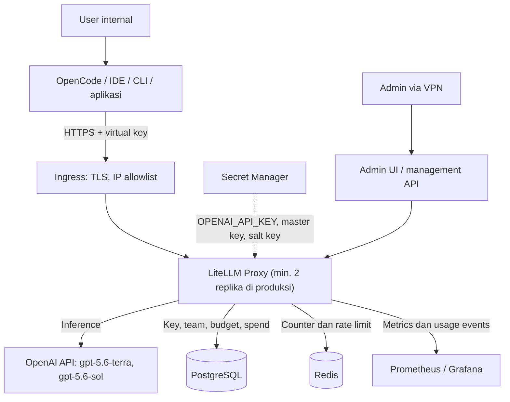

# Acuan Pengerjaan LiteLLM Gateway — Rilis Awal

Tanggal: 27 Oktober 2026
Status: Acuan kerja rilis awal
Acuan desain: `LLM_GATEWAY_ARCHITECTURE.md`
Lingkup rilis awal: satu provider (OpenAI API), dua model (GPT-5.6 Terra dan GPT-5.6 Sol)

> Dokumen ini adalah turunan eksekusi dari dokumen arsitektur. Jika ada konflik, prinsip di dokumen arsitektur yang berlaku, lalu dokumen ini diperbarui. Semua contoh konfigurasi perlu diverifikasi terhadap versi LiteLLM dan OpenCode yang dipin.

---

## Daftar isi

1. [Ringkasan dan keputusan terkunci](#1-ringkasan-dan-keputusan-terkunci)
2. [Arsitektur rilis awal](#2-arsitektur-rilis-awal)
3. [Katalog alias model](#3-katalog-alias-model)
4. [Team, entitlement, dan policy](#4-team-entitlement-dan-policy)
5. [Konfigurasi referensi](#5-konfigurasi-referensi)
6. [Fase pengerjaan dan checklist](#6-fase-pengerjaan-dan-checklist)
7. [Skenario uji penerimaan](#7-skenario-uji-penerimaan)
8. [Runbook ringkas](#8-runbook-ringkas)
9. [Risiko dan mitigasi](#9-risiko-dan-mitigasi)
10. [Pertanyaan terbuka](#10-pertanyaan-terbuka)
11. [Referensi](#11-referensi)

---

## 1. Ringkasan dan keputusan terkunci

Target: LiteLLM proxy dipakai seluruh tim dalam **±7 minggu**, melalui 4 fase dengan 3 gate. Semua akses model lewat satu endpoint internal, setiap orang memegang virtual key sendiri, dan biaya bisa dibatasi serta dilacak per user dan per tim.

| Keputusan | Nilai rilis awal |
| --- | --- |
| Provider | **OpenAI API** (billing platform). Bukan langganan ChatGPT Plus/Pro/Team. |
| Model | `gpt-5.6-terra` (default harian), `gpt-5.6-sol` (tugas berat). ID lengkap dipin, bukan alias `gpt-5.6`. |
| Client utama | OpenCode, lalu IDE/CLI lain, Open WebUI, dan aplikasi internal |
| Deploy | Pilot: Docker Compose di 1 VM. Produksi: Kubernetes + Helm, minimal 2 replika |
| State | Managed PostgreSQL + managed Redis 7.0+ |
| Autentikasi | Virtual key individual per user; service account key per aplikasi |
| Administrasi | Admin UI bawaan + skrip provisioning. Portal custom hanya bila alur perusahaan menuntut |
| Caching | Response caching **mati** |
| Logging | Metadata saja. Prompt/output dan key mentah tidak disimpan |
| Kegagalan dependency | **Fail-closed**: jika key/budget tidak bisa diperiksa, request ditolak |
| Lisensi | Open source. Evaluasi Enterprise bila butuh SSO/SCIM/audit log bawaan |

Di luar lingkup rilis awal: provider lain (Azure OpenAI, Gemini, DeepSeek, GLM), GPT-5.6 Luna, model lokal, portal custom, guardrail/PII masking otomatis, SCIM.

---

## 2. Arsitektur rilis awal



Prinsip yang wajib dijaga:

- Credential OpenAI hanya ada di gateway. User tidak pernah memegang API key OpenAI.
- Identitas untuk enforcement berasal dari virtual key yang divalidasi, bukan dari field `user` atau header yang dikirim client.
- Endpoint inference dan endpoint administrasi dipisah aksesnya. Master key hanya dipakai skrip/admin terpercaya.
- Perubahan resource LiteLLM lewat management API, tidak menulis langsung ke tabel internalnya.
- Satu sumber kebenaran per data: IdP untuk identitas dan grup, daftar entitlement untuk izin alias, LiteLLM untuk key dan usage.

---

## 3. Katalog alias model

| Alias | Model OpenAI | Kegunaan | Harga input / output per 1M token* | Saat gagal |
| --- | --- | --- | --- | --- |
| `company-fast` | `gpt-5.6-terra` | Chat harian, ringkasan, tanya-jawab | $2 / $12 | Retry terbatas |
| `company-coding` | `gpt-5.6-terra` | Coding harian, agent di OpenCode | $2 / $12 | Retry terbatas |
| `company-reasoning` | `gpt-5.6-sol` | Coding sulit, analisis kompleks, agent panjang | $4 / $20 | Retry, lalu fallback ke `company-coding` sebelum output terkirim |

\*Tier Standard per 2026-10-30, untuk konteks hingga 272K token; konteks lebih panjang lebih mahal. Input yang dilayani dari cache prompt: $0.20 (Terra) dan $0.40 (Sol). Harga Sol adalah promo sampai setidaknya 2026-11-21. Harga yang dipakai gateway adalah yang dipin di `deploy/litellm/config.yaml`; verifikasi di halaman harga OpenAI sebelum menetapkan budget.

Aturan katalog:

- `company-fast` dan `company-coding` sengaja dipisah walau modelnya sama, supaya `company-coding` bisa dinaikkan ke model lain tanpa mengubah client.
- Setiap perubahan mapping (misalnya pindah ke Sol generasi baru) wajib lolos uji T06, T07, dan T09 di staging sebelum produksi, dan dicatat di audit administrasi.
- Simpan metadata per alias: owner, model aktual, kelas data yang diizinkan, versi mapping, tanggal berlaku.

---

## 4. Team, entitlement, dan policy

### 4.1 Matriks akses awal

Angka berikut ilustrasi; sesuaikan setelah 2 minggu pemakaian.

| Team | `company-fast` | `company-coding` | `company-reasoning` | Budget team (USD/bulan) | Budget per anggota | Rate limit per key |
| --- | --- | --- | --- | --- | --- | --- |
| IT / Developer | Ya | Ya | Ya | 500 | 10/hari, 100/bulan | 60 RPM |
| Finance | Ya | Tidak | Tidak | 100 | 3/hari, 30/bulan | 30 RPM |
| HR | Ya | Tidak | Tidak | 100 | 3/hari, 30/bulan | 30 RPM |
| Service account | Sesuai aplikasi | Sesuai aplikasi | Sesuai aplikasi | Per aplikasi | — | Sesuai beban |

### 4.2 Aturan policy

1. **Akses efektif** = irisan izin key, user, dan team. Request harus lolos semua limit yang berlaku.
2. **Fallback** hanya ke alias yang juga diizinkan untuk key tersebut. Saat ini aman karena semua pemegang `company-reasoning` juga punya `company-coding`.
3. **Budget** direset per jendela (24 jam dan 30 hari). Tetapkan zona waktu reset dan toleransi overshoot untuk request paralel.
4. **Rate limit per key dan per team** dijaga di bawah rate limit organisasi OpenAI, karena limit organisasi dipakai bersama seluruh tim.
5. **Aplikasi** selalu memakai service account key milik team, bukan key personal.
6. **Akses `company-reasoning`** untuk team di luar IT/Developer lewat permintaan dan persetujuan.

---

## 5. Konfigurasi referensi

### 5.1 Environment variable

| Variabel | Fungsi | Catatan |
| --- | --- | --- |
| `LITELLM_MASTER_KEY` | Admin key proxy | Diawali `sk-`; hanya di secret manager |
| `LITELLM_SALT_KEY` | Enkripsi kredensial di DB | **Jangan pernah diganti** setelah ada data; backup terpisah |
| `DATABASE_URL` | Koneksi Postgres | Gunakan TLS ke DB |
| `OPENAI_API_KEY` | API key OpenAI Project khusus gateway | Rotasi tiap 90 hari |
| `REDIS_HOST`, `REDIS_PORT`, `REDIS_PASSWORD` | Shared state | Jangan pakai `redis_url` |
| `LITELLM_MODE` | `PRODUCTION` | Menonaktifkan auto-load `.env` |
| `DISABLE_SCHEMA_UPDATE` | `true` di pod produksi | Migrasi lewat Job terpisah |

### 5.2 `config.yaml`

```yaml
model_list:
  - model_name: company-fast
    litellm_params:
      model: openai/gpt-5.6-terra
      api_key: os.environ/OPENAI_API_KEY
  - model_name: company-coding
    litellm_params:
      model: openai/gpt-5.6-terra
      api_key: os.environ/OPENAI_API_KEY
  - model_name: company-reasoning
    litellm_params:
      model: openai/gpt-5.6-sol
      api_key: os.environ/OPENAI_API_KEY

router_settings:
  routing_strategy: simple-shuffle
  num_retries: 2
  redis_host: os.environ/REDIS_HOST
  redis_port: os.environ/REDIS_PORT
  redis_password: os.environ/REDIS_PASSWORD
  fallbacks: [{"company-reasoning": ["company-coding"]}]

general_settings:
  master_key: os.environ/LITELLM_MASTER_KEY
  database_url: os.environ/DATABASE_URL
  # Jangan aktifkan allow_requests_on_db_unavailable: gateway harus fail-closed.
```

Setelah deploy, reload model cost map dari Admin UI agar harga Terra dan Sol tercatat benar.

### 5.3 `docker-compose.yml` untuk pilot

```yaml
services:
  litellm:
    image: ghcr.io/berriai/litellm:<versi-stable>@sha256:<digest>  # min. v1.93.0-stable
    command: ["--config", "/app/config.yaml", "--port", "4000"]
    ports:
      - "127.0.0.1:4000:4000"   # hanya diakses lewat reverse proxy HTTPS
    volumes:
      - ./config.yaml:/app/config.yaml:ro
    env_file: .env.litellm      # pilot saja; produksi memakai secret manager
    depends_on: [postgres, redis]
    restart: unless-stopped

  postgres:
    image: postgres:16
    environment:
      POSTGRES_DB: litellm
      POSTGRES_USER: litellm
      POSTGRES_PASSWORD: ${POSTGRES_PASSWORD}
    volumes:
      - pgdata:/var/lib/postgresql/data
    restart: unless-stopped

  redis:
    image: redis:7
    command: ["redis-server", "--requirepass", "${REDIS_PASSWORD}"]
    restart: unless-stopped

volumes:
  pgdata:
```

Reverse proxy di depan LiteLLM wajib mendukung streaming: matikan response buffering (misalnya `proxy_buffering off` di Nginx) dan set read timeout panjang (mis. 600 detik) untuk agent yang berjalan lama.

### 5.4 Provisioning team, member, dan key

Buat team:

```bash
curl -X POST https://llm.perusahaan.internal/team/new \
  -H "Authorization: Bearer $LITELLM_MASTER_KEY" \
  -H "Content-Type: application/json" \
  -d '{
    "team_id": "it-developer",
    "team_alias": "IT / Developer",
    "models": ["company-fast", "company-coding", "company-reasoning"],
    "max_budget": 500,
    "budget_duration": "30d",
    "rpm_limit": 600
  }'
```

Tambahkan anggota dengan budget individu di dalam team:

```bash
curl -X POST https://llm.perusahaan.internal/team/member_add \
  -H "Authorization: Bearer $LITELLM_MASTER_KEY" \
  -H "Content-Type: application/json" \
  -d '{
    "team_id": "it-developer",
    "member": {"role": "user", "user_id": "budi@perusahaan.com"},
    "max_budget_in_team": 100
  }'
```

Buat virtual key individual:

```bash
curl -X POST https://llm.perusahaan.internal/key/generate \
  -H "Authorization: Bearer $LITELLM_MASTER_KEY" \
  -H "Content-Type: application/json" \
  -d '{
    "user_id": "budi@perusahaan.com",
    "team_id": "it-developer",
    "key_alias": "budi-opencode",
    "models": ["company-fast", "company-coding", "company-reasoning"],
    "rpm_limit": 60,
    "budget_limits": [
      {"budget_duration": "24h", "max_budget": 10},
      {"budget_duration": "30d", "max_budget": 100}
    ]
  }'
```

Blokir key (offboarding atau kebocoran):

```bash
curl -X POST https://llm.perusahaan.internal/key/block \
  -H "Authorization: Bearer $LITELLM_MASTER_KEY" \
  -H "Content-Type: application/json" \
  -d '{"key": "sk-..."}'
```

### 5.5 Contoh konfigurasi OpenCode

Simpan virtual key di environment variable user, jangan di file yang di-commit.

```json
{
  "$schema": "https://opencode.ai/config.json",
  "provider": {
    "company": {
      "npm": "@ai-sdk/openai-compatible",
      "name": "Company LLM Gateway",
      "options": {
        "baseURL": "https://llm.perusahaan.internal/v1",
        "apiKey": "{env:COMPANY_LLM_KEY}"
      },
      "models": {
        "company-coding": { "name": "Company Coding (Terra)" },
        "company-reasoning": { "name": "Company Reasoning (Sol)" }
      }
    }
  }
}
```

Verifikasi format ini terhadap versi OpenCode yang dipakai tim, lalu jadikan template resmi di panduan onboarding.

---

## 6. Fase pengerjaan dan checklist

```
Minggu:   1          2      3      4      5      6      7
          [Fase 0]   [ Fase 1 ]    [ Fase 2 ]    [ Fase 3 ]
                  ◆ G1          ◆ G2          ◆ G3         ◆ Go-live
```

| Gate | Syarat lolos |
| --- | --- |
| Gate 1 | Semua keputusan terkunci, secret dan akun OpenAI siap |
| Gate 2 | Uji T01–T11 lulus, overshoot dalam toleransi, selisih spend < 5% |
| Gate 3 | Uji T12–T16 lulus, dashboard/alert/audit aktif, runbook tersedia |
| Go-live | 100% pengguna aktif lewat proxy, key OpenAI individual dicabut |

Jika gate gagal, fase diperpanjang, bukan dilewati.

### Fase 0 — Persiapan (minggu 1)

- [ ] Kunci keputusan di bagian 1 dan dokumentasikan alasannya
- [ ] Inventaris user, team, dan alias yang dibutuhkan tiap team
- [ ] Buat OpenAI Project khusus gateway atas nama perusahaan
- [ ] Cek usage tier dan rate limit organisasi OpenAI untuk Terra dan Sol
- [ ] Pasang budget dan alert di level OpenAI Project sebagai pengaman kedua
- [ ] Konfirmasi ID model persis (`gpt-5.6-terra`, `gpt-5.6-sol`) atau generasi yang lebih baru
- [ ] Tetapkan kebijakan data: kelas data apa yang boleh dikirim ke OpenAI
- [ ] Tetapkan toleransi overshoot budget dan target waktu pencabutan key (mis. maks. 5 menit)
- [ ] Generate `LITELLM_MASTER_KEY` dan `LITELLM_SALT_KEY`, simpan di secret manager
- [ ] Siapkan domain internal (mis. `llm.perusahaan.internal`) dan sertifikat TLS
- [ ] Pilih versi LiteLLM (min. v1.93.0-stable) dan pin ke image digest

### Fase 1 — Pilot (minggu 2–3)

Setup:

- [ ] Deploy Docker Compose (bagian 5.3) di belakang reverse proxy HTTPS
- [ ] Terapkan `config.yaml` (bagian 5.2) dengan 3 alias
- [ ] Response caching mati; Redis hanya untuk counter dan rate limit
- [ ] `LITELLM_MODE=PRODUCTION` sejak awal
- [ ] Admin UI hanya dari VPN
- [ ] Buat team pilot: IT/Developer + 1 team non-teknis
- [ ] Provision 5–10 pengguna pilot (bagian 5.4)
- [ ] Logging metadata aktif, tanpa prompt/output dan key mentah
- [ ] Reload model cost map
- [ ] Siapkan template OpenCode dan panduan onboarding singkat

Uji: jalankan T01–T11 (bagian 7) dan kumpulkan feedback pilot (latency, kualitas Terra vs Sol, kemudahan setup).

### Fase 2 — Produksi HA (minggu 4–5)

Infrastruktur:

- [ ] Managed Postgres (backup harian, point-in-time recovery) dan managed Redis 7.0+
- [ ] Deploy via Helm chart resmi dengan `db.useExisting: true`, minimal 2 replika
- [ ] HPA dengan `maxReplicas` realistis; hitung koneksi DB = replika × worker × pool size
- [ ] PgBouncer bila total koneksi mendekati batas Postgres
- [ ] Ingress dengan TLS, IP allowlist/WAF, dukungan streaming dan timeout panjang
- [ ] Liveness dan readiness probe ke endpoint health LiteLLM
- [ ] Network policy: outbound hanya ke endpoint OpenAI yang diperlukan

Database dan migrasi:

- [ ] `DISABLE_SCHEMA_UPDATE=true` di pod LiteLLM
- [ ] Migrasi sebagai Kubernetes Job sebelum setiap upgrade
- [ ] Migrasikan atau buat ulang team, user, dan key dari pilot

Observability dan audit:

- [ ] Dashboard: request/menit, latency p95, time to first token, error rate, spend harian per team dan per alias
- [ ] Alert: error rate > 5%, lonjakan latency, lonjakan 429 dari OpenAI, Postgres/Redis down, spend team mendekati batas, kegagalan provisioning/offboarding
- [ ] Audit administrasi: siapa membuat/mencabut key, mengubah budget, atau mengganti mapping alias, dengan nilai sebelum/sesudah

Uji: jalankan T12–T16 (bagian 7).

### Fase 3 — Rollout dan governance (minggu 6–7)

Rollout:

- [ ] Gelombang 1: team pilot + 1 team tambahan
- [ ] Gelombang 2: team sisanya, satu per satu dengan jeda 2–3 hari
- [ ] Sesi onboarding 30 menit per team
- [ ] Cabut API key OpenAI individual setelah semua team pindah

Governance:

- [ ] Tetapkan pemilik gateway (platform/DevOps) dan admin per team
- [ ] Proses permintaan key baru, akses `company-reasoning`, dan kenaikan budget
- [ ] Offboarding terintegrasi dengan alur HR/IdP (lihat runbook 8.2)
- [ ] Rekonsiliasi mingguan: key milik user nonaktif atau team yang salah dibersihkan
- [ ] Laporan spend bulanan per team untuk chargeback
- [ ] Jadwal: rotasi master key dan API key OpenAI tiap 90 hari, review mapping alias tiap bulan, upgrade LiteLLM lewat staging
- [ ] Evaluasi kebutuhan SSO/SCIM/audit log bawaan dan lisensi Enterprise

---

## 7. Skenario uji penerimaan

| ID | Skenario | Langkah | Hasil yang diharapkan | Gate |
| --- | --- | --- | --- | --- |
| T01 | Entitlement | Key team Finance memanggil `company-reasoning` | Ditolak dengan error akses model | G2 |
| T02 | Budget habis | Key dengan budget sangat kecil dipakai sampai habis | Request berikutnya ditolak `budget_exceeded` | G2 |
| T03 | Budget paralel | 10–20 request bersamaan mendekati batas | Overshoot ≤ toleransi yang ditetapkan | G2 |
| T04 | Rate limit | Kirim request melebihi `rpm_limit` | Error 429 dari gateway | G2 |
| T05 | Pencabutan key | Blokir key yang sedang aktif | Request baru ditolak di semua replika ≤ target waktu | G2 |
| T06 | Streaming OpenCode | Sesi OpenCode di `company-coding` dan `company-reasoning` | Token mengalir bertahap tanpa putus/timeout | G2 |
| T07 | Tool calling OpenCode | Tugas agent yang memanggil tool/edit file | Tool call dan hasilnya terproses benar di Terra dan Sol | G2 |
| T08 | Retry | Simulasikan 429/5xx dari OpenAI | Maks. 2 retry dengan backoff; tidak berlapis dengan retry client | G2 |
| T09 | Fallback | Gagalkan Sol sebelum output pertama | Request pindah ke Terra, tercatat di log; tidak pernah pindah di tengah stream | G2 |
| T10 | Kebersihan log | Periksa log setelah uji | Tidak ada key mentah, API key OpenAI, header authorization, atau prompt | G2 |
| T11 | Rekonsiliasi spend | Bandingkan `/team/info` dengan usage OpenAI Project | Selisih < 5% | G2 |
| T12 | Redis down | Matikan Redis sementara | Limit/budget tidak diam-diam terlewati; perilaku terdokumentasi | G3 |
| T13 | Postgres down | Matikan Postgres sementara | Request baru ditolak (fail-closed) | G3 |
| T14 | Replika mati | Matikan 1 pod | Trafik tetap jalan | G3 |
| T15 | Restore | Restore backup Postgres ke staging | Key, team, dan spend kembali utuh | G3 |
| T16 | Load test | Beban puncak perkiraan | Latency p95 sesuai target, tetap di bawah rate limit organisasi OpenAI | G3 |

---

## 8. Runbook ringkas

### 8.1 Onboarding user

1. Pastikan user ada di grup IdP yang benar.
2. Tambahkan ke team (`/team/member_add`) dengan budget individu.
3. Generate virtual key (`/key/generate`) dengan alias sesuai entitlement.
4. Kirim key lewat kanal aman; user memasangnya sebagai environment variable dan memakai template OpenCode.
5. Catat di audit administrasi.

### 8.2 Offboarding user

Menonaktifkan akun SSO **tidak** mencabut virtual key.

1. Cari semua key milik user (filter `user_id`).
2. Blokir atau hapus setiap key.
3. Hapus keanggotaan team dan entitlement.
4. Verifikasi: request dengan key lama ditolak di semua replika.
5. Catat hasil di audit; kegagalan memicu alert.

### 8.3 OpenAI tidak tersedia atau 429 massal

1. Cek status OpenAI dan dashboard gateway (error rate, 429).
2. Jika 429 karena limit organisasi: turunkan sementara `rpm_limit` team non-prioritas, identifikasi key dengan trafik terbesar.
3. Jika OpenAI down: umumkan ke tim; tidak ada provider cadangan di rilis awal.
4. Setelah pulih: catat durasi dan dampak untuk evaluasi deployment kedua (mis. Azure OpenAI).

### 8.4 Rotasi API key OpenAI

1. Buat key baru di OpenAI Project.
2. Perbarui secret manager.
3. Rolling restart pod LiteLLM; pastikan request berhasil.
4. Cabut key lama di OpenAI.

### 8.5 Upgrade LiteLLM

1. Baca release notes; pin versi dan digest baru.
2. Backup Postgres.
3. Deploy ke staging, jalankan migration Job, jalankan T01–T09.
4. Produksi: migration Job, lalu rolling update.
5. Rollback: image lama + backup yang kompatibel.

### 8.6 Ganti mapping alias

1. Ubah `config.yaml` di staging (mis. `company-reasoning` ke Sol generasi baru).
2. Jalankan T06, T07, T09 dan bandingkan biaya per tugas.
3. Deploy produksi, umumkan perubahan, catat versi mapping di audit.

---

## 9. Risiko dan mitigasi

| Risiko | Dampak | Mitigasi |
| --- | --- | --- |
| Satu provider (OpenAI) | Gangguan OpenAI menghentikan layanan | Diterima untuk rilis awal; alert dan runbook 8.3; Azure OpenAI sebagai deployment kedua di fase berikutnya |
| Rate limit organisasi OpenAI dipakai bersama | Satu agent berat memicu 429 untuk semua | Limit per key dan team di bawah limit organisasi; naikkan usage tier bila perlu |
| Biaya Sol tinggi pada agent panjang | Budget team cepat habis | Terra sebagai default; Sol lewat entitlement; budget harian per user |
| Budget overshoot pada request paralel | Biaya melewati batas | Toleransi tertulis, uji T03, `max_parallel_requests` per key bila perlu, budget di OpenAI Project |
| Fallback melanggar entitlement | User mendapat model yang tidak diizinkan | Fallback hanya ke alias yang juga diizinkan untuk key tersebut |
| Redis atau Postgres down | Limit tidak konsisten atau request lolos tanpa pemeriksaan | Fail-closed; Redis wajib sebelum replika kedua; managed HA; uji T12–T15 |
| Koneksi DB habis saat autoscale | Error massal | Batasi `maxReplicas`, PgBouncer, pantau koneksi |
| Key tidak dicabut saat karyawan keluar | Akses tetap aktif | Runbook 8.2, rekonsiliasi mingguan |
| Prompt/output tersimpan di log | Kebocoran data | Metadata saja; prompt hanya dengan persetujuan, redaction, retensi |
| Master key atau salt key bocor/hilang | Akses penuh / kredensial tak bisa didekripsi | Secret manager, akses terbatas, rotasi, backup salt key |
| Mapping model berubah diam-diam | Biaya atau perilaku berubah | Pin ID lengkap; runbook 8.6 |
| Upgrade merusak skema atau perilaku | Downtime | Runbook 8.5 |
| Pengguna tetap memakai akun/key pribadi | Biaya dan data tidak terlacak | Cabut key lama; kebijakan pemakaian tertulis |

---

## 10. Pertanyaan terbuka

- [ ] Jumlah pengguna dan team, serta berapa yang butuh akses Sol?
- [ ] Infra produksi: Kubernetes yang sudah ada, VM, atau cloud tertentu?
- [ ] Generasi model: GPT-5.6 Terra/Sol, atau Sol generasi lebih baru yang sudah dirilis OpenAI?
- [ ] Usage tier organisasi OpenAI saat ini dan apakah rate limit-nya cukup?
- [ ] Identity Provider yang dipakai untuk SSO dan offboarding?
- [ ] Toleransi overshoot budget dan target waktu pencabutan key?
- [ ] Data apa yang tidak boleh dikirim ke OpenAI?
- [ ] Siapa pemilik gateway dan admin per team?

---

## 11. Referensi

- `LLM_GATEWAY_ARCHITECTURE.md` — dokumen arsitektur internal
- [LiteLLM: Day 0 Support GPT-5.6 (Sol, Terra, Luna)](https://docs.litellm.ai/blog/gpt_5_6)
- [LiteLLM: Production Best Practices](https://docs.litellm.ai/docs/proxy/prod)
- [LiteLLM: Budgets, Rate Limits](https://docs.litellm.ai/docs/proxy/users)
- [LiteLLM: Virtual Keys](https://docs.litellm.ai/docs/proxy/virtual_keys)
- [LiteLLM: What is stored in the DB](https://docs.litellm.ai/docs/proxy/db_info)
- [LiteLLM: Enterprise Quickstart](https://docs.litellm.ai/docs/learn/enterprise_quickstart)
