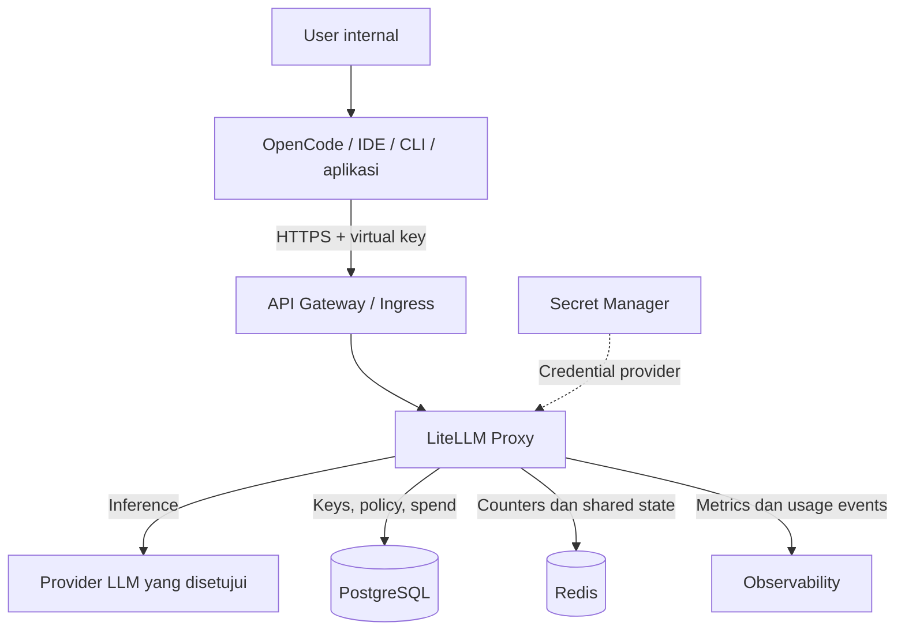
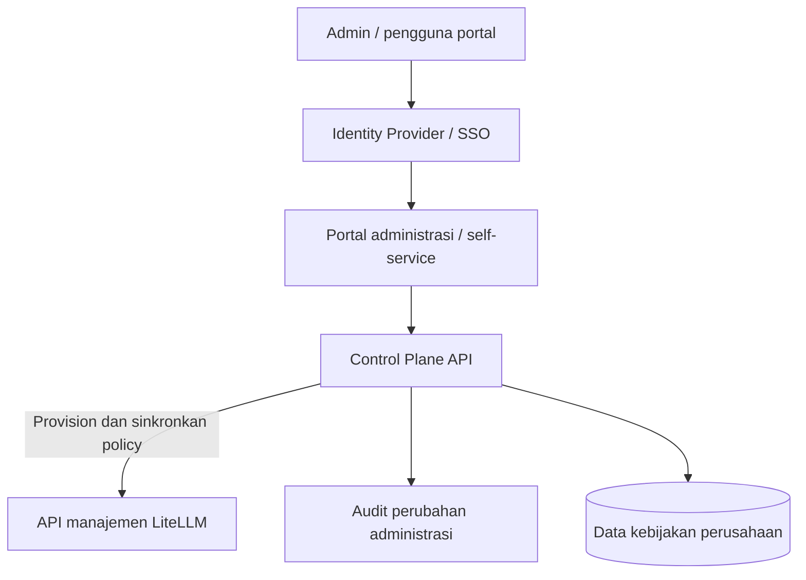
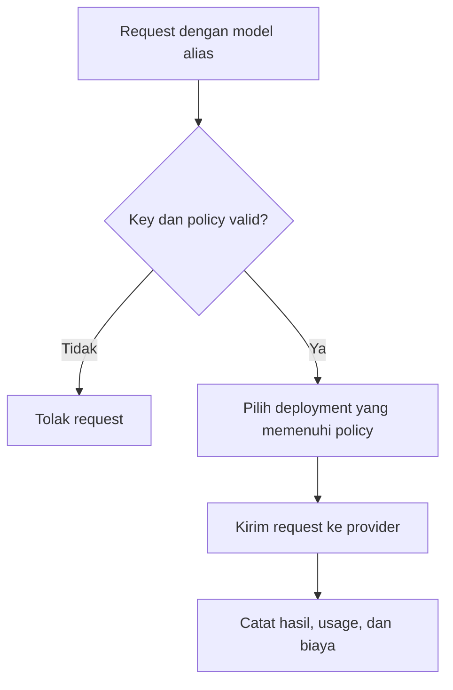

# Arsitektur Internal LLM Gateway dengan LiteLLM

Tanggal: 27 Oktober 2026  
Status: Usulan arsitektur berdasarkan pembahasan awal  
Target: Tim internal yang mengakses beberapa provider LLM melalui OpenCode, IDE, CLI, atau aplikasi internal.

> Dokumen ini merangkum rancangan yang dibahas dalam percakapan. Contoh policy merupakan desain konseptual, bukan konfigurasi LiteLLM yang dapat langsung dijalankan. Dukungan fitur, lisensi, dan parameter implementasi perlu diperiksa terhadap versi LiteLLM yang dipilih.

## 1. Tujuan

Menyediakan satu endpoint LLM internal dengan kontrol akses per user dan tim, tanpa membagikan credential provider kepada pengguna.

Kemampuan yang dituju:

- Mengakses beberapa model/provider melalui API yang kompatibel dengan client yang digunakan.
- Mengatur model yang boleh digunakan setiap user dan tim.
- Membatasi biaya, request, dan token.
- Melacak penggunaan, biaya, latency, dan kegagalan.
- Mengganti deployment model tanpa mengubah konfigurasi seluruh client.
- Menjaga credential provider dan data perusahaan.

Nama produk yang digunakan dalam dokumen ini adalah **LiteLLM Proxy**.

## 2. Prinsip desain

Pisahkan **Control Plane**, yang menetapkan aturan perusahaan, dari **Data Plane**, yang menjalankan request LLM.

| Aspek | Control Plane | Data Plane |
| --- | --- | --- |
| Pertanyaan utama | Siapa boleh menggunakan apa, dengan batas berapa? | Bagaimana request dieksekusi ke provider? |
| Komponen | Portal, identity integration, provisioning, policy management | API Gateway/Ingress, LiteLLM, router, provider adapters |
| Tanggung jawab | User, tim, lifecycle key, approval bila diperlukan, audit perubahan | Validasi key, enforcement policy, routing, retry, fallback, usage events |
| Perubahan | Perubahan policy dan konfigurasi | Request inference dan streaming |

LiteLLM menjadi titik enforcement untuk kontrol yang didukungnya. Business logic perusahaan berada pada Control Plane; hindari membangun pemeriksaan yang sama pada beberapa lapisan tanpa sumber aturan yang jelas.

Untuk MVP, manfaatkan kemampuan administrasi bawaan yang memenuhi kebutuhan. Portal custom dibangun ketika alur perusahaan memerlukannya.

## 3. Arsitektur target

### 3.1 Jalur request LLM



Provider dapat mencakup Gemini melalui layanan Google yang dipilih, DeepSeek API, serta endpoint/model lain yang telah disetujui. Identifikasi model dan penyedia endpoint secara terpisah; nama model GLM tidak otomatis berarti endpoint Huawei.

Observability menerima telemetry dari gateway. Observability bukan hop yang harus dilewati respons provider sebelum kembali ke client.

### 3.2 Jalur administrasi



Control Plane mengelola perubahan melalui API manajemen yang didukung. Hindari menulis langsung ke tabel internal LiteLLM karena skema dan perilakunya dapat berubah.

Tentukan satu sumber otoritatif untuk setiap jenis data. Sebagai contoh, IdP untuk identitas dan grup; Control Plane untuk entitlement perusahaan; LiteLLM untuk resource operasional gateway dan usage. Gunakan rekonsiliasi agar perubahan policy yang gagal tersinkron dapat ditemukan dan diperbaiki.

## 4. Tanggung jawab komponen

| Komponen | Tanggung jawab |
| --- | --- |
| OpenCode / IDE / CLI | Mengirim model alias, payload, dan virtual key ke endpoint internal |
| Identity Provider | SSO portal, identitas karyawan, dan sumber keanggotaan grup |
| API Gateway / Ingress | TLS, pembatasan jaringan, ukuran request, access logs, dan WAF bila diperlukan |
| LiteLLM Proxy | Autentikasi request, model access, limit/budget yang didukung, routing, dan pencatatan usage |
| Control Plane API | Lifecycle user/key, mapping grup ke tim, policy perusahaan, dan rekonsiliasi |
| PostgreSQL | Persistensi resource gateway dan catatan penggunaan sesuai konfigurasi |
| Redis | State bersama untuk counter, rate limit, dan kebutuhan routing/cache sesuai konfigurasi |
| Secret Manager | Credential provider, master/admin secret, dan rotasi secret |
| Observability | Metrics, traces, alert, serta analisis penggunaan dan biaya |

Pisahkan akses endpoint inference dari endpoint administrasi. Master/admin key hanya digunakan oleh layanan administrasi yang dipercaya.

## 5. Identitas dan virtual API key

Credential provider hanya tersedia pada server gateway melalui mekanisme secret management. Pengguna mendapatkan **virtual key individual** yang dikaitkan dengan user dan tim.

Contoh alur:

1. User login ke portal menggunakan SSO perusahaan.
2. Keanggotaan grup dipetakan ke tim dan entitlement.
3. Sistem membuat atau menyediakan virtual key dengan model access, expiry, dan limit yang sesuai.
4. User memasang endpoint internal dan virtual key pada OpenCode/IDE.
5. Gateway mengatribusikan request ke identitas pemilik key.

Hindari satu shared key untuk seluruh tim jika diperlukan atribusi per user. Gunakan service account/key terpisah untuk automation dan aplikasi.

Client tidak boleh menentukan identitas otoritatif hanya melalui field `user_id` atau header yang dapat diubah sendiri. Identitas untuk enforcement harus berasal dari credential yang divalidasi.

### Offboarding dan pencabutan akses

Menonaktifkan akun SSO **tidak otomatis mencabut virtual key yang sudah terbit**. Rancang integrasi offboarding untuk:

- Menonaktifkan user dan mencabut seluruh key terkait.
- Menghapus entitlement yang tidak lagi berlaku.
- Menginvalidasi cache autentikasi/policy sesuai mekanisme gateway.
- Mengaudit hasil dan menangani kegagalan sinkronisasi.

Tentukan batas waktu pencabutan akses yang dapat diterima dan uji menggunakan key yang sudah aktif.

## 6. Katalog model dan alias

Gunakan nama model logis untuk menyederhanakan konfigurasi client.

| Alias internal | Tujuan | Mapping konseptual |
| --- | --- | --- |
| `company-fast` | Request umum dengan latency rendah | Deployment cepat yang disetujui |
| `company-coding` | Coding dan penggunaan agent | Deployment yang lolos evaluasi coding/tool calling |
| `company-reasoning` | Analisis lebih kompleks | Deployment reasoning yang disetujui |
| `company-cheap` | Beban kerja dengan prioritas biaya | Deployment hemat yang memenuhi kualitas minimum |

Alias membuat perubahan provider/deployment dapat dikelola di gateway. Namun, alias tidak menjamin perilaku model identik. Setiap perubahan mapping perlu diuji, terutama untuk tool calling, structured output, context window, streaming, dan batas output.

Simpan informasi katalog seperti owner, provider endpoint, region, kelas data yang diizinkan, kemampuan model, dan versi mapping.

## 7. Hierarki user, tim, dan policy

Struktur konseptual:

- Organization memiliki beberapa tim.
- User memiliki keanggotaan tim dan entitlement tertentu.
- Virtual key dikaitkan dengan user, tim/proyek, dan policy yang berlaku.
- Tim dan user mempunyai batas penggunaan sesuai kebutuhan.

Contoh matriks akses:

| Tim | company-fast | company-coding | company-reasoning | Anggaran bulanan contoh |
| --- | --- | --- | --- | --- |
| IT / Developer | Ya | Ya | Ya | USD 500 |
| Finance | Ya | Tidak | Tidak | USD 100 |
| HR | Ya | Tidak | Tidak | USD 100 |

Nilai tersebut hanya ilustrasi dan perlu disesuaikan dengan jumlah pengguna serta workload.

### Contoh policy konseptual

```yaml
# Skema desain internal; bukan format config.yaml LiteLLM.
team: IT
allowed_models:
  - company-fast
  - company-coding
  - company-reasoning
budget:
  amount: 500
  currency: USD
  period: calendar_month
rate_limit:
  requests_per_minute: 100
  tokens_per_minute: 200000
```

Definisikan cara menghitung effective policy. Usulan: akses model merupakan irisan izin key, user, dan tim; request harus memenuhi semua limit yang berlaku. Verifikasi bagaimana aturan ini dipetakan ke kemampuan versi LiteLLM yang digunakan.

Tentukan juga zona waktu reset budget, scope limit, dan perilaku ketika budget terlampaui. Jangan menganggap spend tracking asinkron sebagai jaminan batas biaya yang presisi tanpa toleransi overshoot untuk request paralel.

## 8. Pisahkan authorization dan routing

**Authorization** menentukan apakah user boleh menggunakan alias tertentu. **Routing** memilih deployment yang mengeksekusi request setelah akses disetujui.



Routing dan fallback harus tetap berada dalam batas region, klasifikasi data, kemampuan model, serta biaya yang diizinkan. User tidak boleh mendapatkan akses deployment terlarang melalui fallback.

## 9. Retry dan fallback

Contoh strategi untuk `company-fast`: gunakan deployment utama, lalu deployment cadangan yang telah disetujui jika terjadi kegagalan yang layak dicoba ulang.

Aturan operasional:

- Gunakan timeout dan batas total waktu request.
- Batasi jumlah retry dan fallback agar tidak menggandakan latency dan biaya secara berlebihan.
- Terapkan backoff dengan jitter untuk kegagalan sementara, misalnya rate limit atau sebagian error server.
- Hindari mencoba ulang error validasi, credential, atau policy secara membabi buta.
- Cegah retry berlapis antara client, API Gateway, LiteLLM, dan SDK provider.
- Setelah streaming menghasilkan output ke client, jangan mengganti provider secara transparan seolah respons belum dimulai.

Fallback antarmodel perlu evaluasi kompatibilitas tool schema, context window, output format, dan aturan pengiriman data. Client/agent tetap bertanggung jawab atas idempotensi eksekusi tool yang menimbulkan efek pada sistem lain.

## 10. PostgreSQL dan Redis

### PostgreSQL

Gunakan untuk persistensi resource gateway seperti user, tim, virtual key, konfigurasi yang didukung, budget, dan spend/usage sesuai implementasi versi yang dipilih.

Siapkan backup, restore drill, enkripsi koneksi, kontrol akses, retensi data, dan monitoring connection pool. Pisahkan data tambahan portal dari tabel internal LiteLLM, misalnya melalui database atau schema milik Control Plane.

### Redis

Gunakan shared state ketika menjalankan beberapa instance dan membutuhkan counter atau rate limit lintas replica. Response caching adalah keputusan terpisah dan sebaiknya dinonaktifkan sampai aturan isolasi tenant, data sensitif, serta cache key jelas.

Tentukan perilaku ketika dependency gagal. Untuk policy yang wajib ditegakkan, hindari fallback yang diam-diam melewati pemeriksaan akses/budget. Uji dampak kegagalan Redis dan database terhadap request aktif dan request baru.

## 11. Observability dan audit

Catat metadata yang cukup untuk analisis operasional dan atribusi biaya:

| Kelompok | Field contoh |
| --- | --- |
| Korelasi | `request_id`, `trace_id`, timestamp |
| Identitas | `user_id`, `team_id`, ID/fingerprint key yang aman |
| Routing | Alias yang diminta, model aktual, provider, deployment, versi policy |
| Penggunaan | Input/output tokens, estimated/reported cost, currency |
| Performa | Latency, time to first token, status, error category |
| Ketahanan | Jumlah attempt, retry/fallback reason |

Jangan mencatat virtual key mentah, provider secret, atau authorization header. Prompt dan output tidak perlu disimpan secara default; jika dibutuhkan, tetapkan redaction, akses, retensi, dan persetujuan data yang sesuai.

Pisahkan dua kebutuhan:

- **Telemetry inference:** penggunaan model, token, biaya, latency, dan error. Langfuse dapat dievaluasi untuk penelusuran LLM yang lebih detail.
- **Audit administrasi:** siapa mengubah policy, membuat/mencabut key, mengubah budget, atau mengganti mapping model; sertakan nilai sebelum/sesudah dan hasil sinkronisasi.

Alert awal: lonjakan biaya, error rate, latency, budget mendekati batas, provider tidak tersedia, serta kegagalan provisioning/offboarding. Rekonsiliasi estimasi biaya gateway dengan laporan provider.

## 12. Keamanan dan batas kepercayaan

- Gunakan HTTPS sejak MVP dan batasi endpoint administrasi ke jaringan/identitas yang dipercaya.
- Simpan secret di fasilitas secret management yang sesuai lingkungan deployment; siapkan rotasi.
- Tetapkan RBAC untuk platform admin, team admin, dan user.
- Terapkan network policy serta outbound access hanya ke endpoint provider yang diperlukan.
- Gunakan model/provider allowlist berdasarkan klasifikasi data dan region pemrosesan.
- Tambahkan guardrail seperti deteksi PII atau secret ketika kebutuhan data menuntutnya; jangan mengandalkannya sebagai satu-satunya kontrol.
- Lindungi prompt/output yang tersimpan melalui enkripsi, kontrol akses, dan retensi.
- Pastikan reverse proxy mendukung streaming dan timeout koneksi panjang.

WAF/API Gateway khusus dapat ditambahkan sesuai paparan dan standar perusahaan. TLS, pembatasan akses, serta pengamanan secret tetap diperlukan pada tahap awal.

## 13. Tahapan implementasi

### Phase 1 — MVP terkontrol

Susunan: client → endpoint HTTPS internal → LiteLLM → provider, dengan PostgreSQL untuk persistensi yang diperlukan.

Fokus:

- Virtual key individual dan mapping user/tim.
- Katalog alias dan allowlist model.
- Limit serta budget dasar yang telah diverifikasi.
- Usage/cost tracking dan metadata logs tanpa secret.
- Pengujian OpenCode: streaming, tool calling, dan penanganan error.
- Prosedur revoke/rotate key dan backup database.

Gunakan Redis sejak tahap ini jika limit perlu dibagi oleh beberapa replica atau fitur yang dipilih membutuhkannya.

### Phase 2 — Platform internal

Tambahkan integrasi SSO portal, provisioning/offboarding, policy tim, self-service yang diperlukan, shared state, observability terpusat, serta audit perubahan. Evaluasi kemampuan UI bawaan sebelum membangun portal custom.

### Phase 3 — Kesiapan enterprise

Tambahkan HA gateway, database/Redis yang sesuai target availability, load balancing, WAF sesuai kebutuhan, guardrail lanjutan, DR, dan pemisahan region bila ada kebutuhan nyata.

Secret management, TLS, dan keamanan akses tidak ditunda sampai fase ini.

## 14. Kriteria penerimaan awal

1. Key user A tidak dapat memakai model di luar entitlement-nya.
2. Usage dapat ditelusuri ke user, tim, alias, dan deployment aktual tanpa membocorkan secret.
3. Key yang dicabut ditolak dalam batas waktu propagasi yang disepakati, termasuk lintas replica.
4. Limit/budget bekerja sesuai scope dan toleransi yang ditetapkan, termasuk request paralel.
5. Fallback hanya memilih deployment yang diizinkan dan kompatibel.
6. OpenCode dapat melakukan streaming dan tool calling melalui endpoint gateway.
7. Kegagalan provider, Redis, atau database menghasilkan perilaku yang terdokumentasi.
8. Backup dapat direstore dan perubahan policy yang gagal dapat direkonsiliasi.

## 15. Keputusan yang perlu dikonfirmasi sebelum implementasi

| Keputusan | Pengaruh terhadap desain |
| --- | --- |
| Jumlah user dan concurrency | Kapasitas, replica, koneksi, dan batas provider |
| Lingkungan deployment: VM, container, atau Kubernetes | Ingress, secret management, HA, dan operasi |
| Identity Provider perusahaan | SSO, grup, provisioning, dan offboarding |
| Provider, endpoint, region, dan model yang digunakan | Kompatibilitas, klasifikasi data, latency, dan biaya |
| Kebutuhan kontrol per user/tim/proyek | Mapping key, policy, budget, dan audit |
| Budget dan toleransi overshoot | Enforcement biaya dan alert |
| Versi serta edisi/lisensi LiteLLM | Ketersediaan SSO, RBAC, audit, dan fitur lain yang dibutuhkan |
| Penyimpanan prompt/output | Privacy, retensi, akses, dan observability |
| Target availability serta recovery | HA, RTO/RPO, backup, dan DR |

## 16. Referensi implementasi

- [Dokumentasi resmi LiteLLM](https://docs.litellm.ai/)

Dokumen ini merupakan rancangan, bukan hasil verifikasi seluruh fitur pada rilis tertentu. Pin versi gateway, cek dokumentasi resmi untuk konfigurasi/lisensi, dan lakukan proof of concept terhadap kebutuhan di atas sebelum rollout tim.
